# Sprint 1 — MVP: Basic Framework and Functionality

**Project:** Smart soil monitoring and watering-support system  
**Controller:** ESP32  
**Sprint focus:** Analogue sensor acquisition, stability testing, local soil calibration, watering-status classification and a local OLED output.

This document records the development, tests, analysis, decisions and evidence for Sprint 1. The system is designed to help non-expert home and school gardeners interpret soil moisture readings as practical watering guidance, without treating a raw analogue value as a direct soil-moisture percentage.

---
## 1. Sprint 1 objectives and plan

The first priority of this sprint was to establish a reliable **sensing and processing framework** before introducing more complex features. I planned to:

1. Confirm that the ESP32 could receive a signal from an analogue sensor.
2. Investigate how the raw ADC output responded to changing physical conditions.
3. Test stability, response over time and repeatability.
4. Trial software filtering to reduce short-term variation.
5. Replace the preliminary resistive sensor with a capacitive soil-moisture sensor.
6. Calibrate soil conditions locally before setting Dry, Suitable and Wet categories.
7. Add a basic local output once the sensing and classification were working.

### Initial sensing approach

The resistive water sensor already available to me was suitable for **preliminary analogue-input experiments**, but not my intended final soil probe. My inquiry found that exposed resistive electrodes could corrode or drift in damp conditions. A capacitive sensor was considered more appropriate for extended contact with soil and was therefore selected for the later prototype.

### Scope decision

The MVP would prioritise trustworthy soil-moisture measurement and a simple recommendation over a wireless dashboard or fully automatic irrigation. A local display would allow users to check the soil condition without a computer, once basic sensing had been verified.

## 2. Preliminary resistive sensor and ESP32 ADC acquisition

### 2.1 Circuit and purpose

Before the capacitive probe was available, I connected a resistive water sensor to the ESP32 to test analogue acquisition:

| Connection | Configuration |
|---|---|
| Sensor supply | ESP32 3.3 V |
| Sensor ground | Common GND |
| Analogue signal | ESP32 GPIO34 (ADC1-capable input) |

I used **GPIO34** because the sensor output was an analogue signal and only needed to be read by the ESP32; the ESP32's ADC converts the voltage to a number for processing.

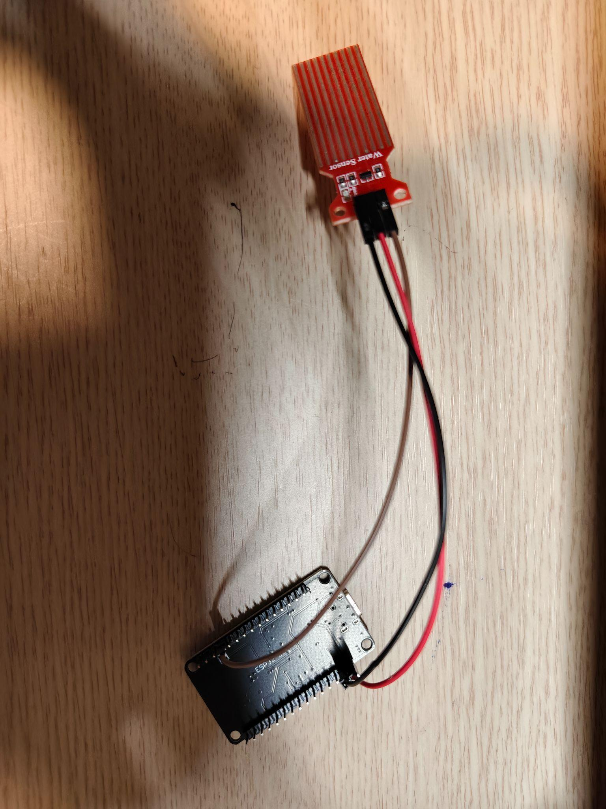

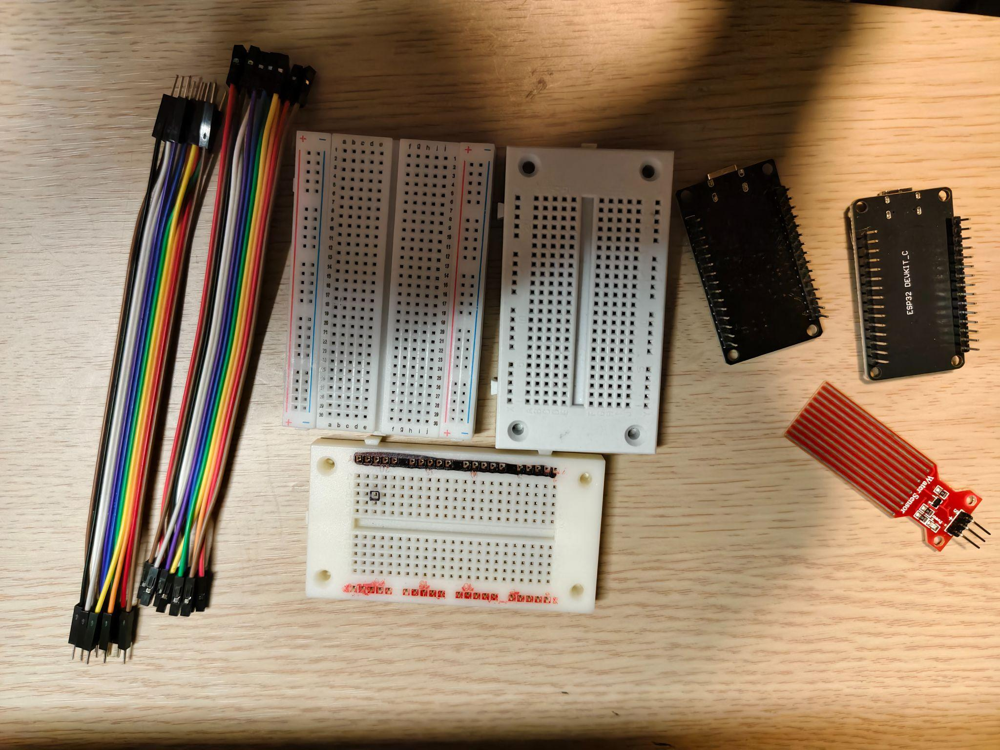

### 2.2 Hypothesis and results

I expected a low reading with dry exposed sensor tracks, and a higher ADC reading when those tracks contacted water.

| Test condition | Observed raw ADC |
|---|---:|
| Completely dry | 0 |
| Tracks in water, across later tests | Approximately 1500–2000 (varied with the physical test condition) |

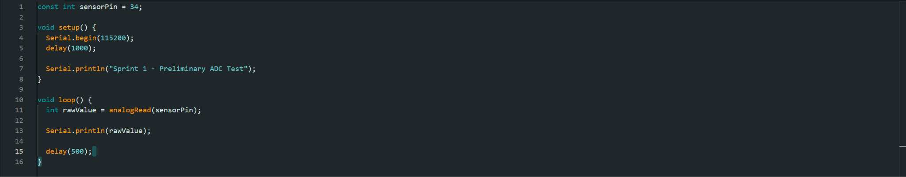

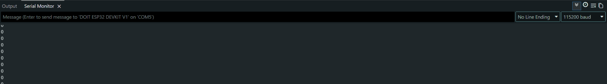

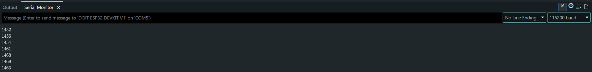

### 2.3 Interpretation

This established that the **ESP32 could acquire an analogue sensor signal**. The ADC number was not, however, a calibrated soil-moisture percentage. Local calibration and attention to the sensing conditions would still be needed before that value could support watering decisions.

## 3. Response-over-time and immersion-depth tests

### 3.1 Reason for further testing

The preliminary sensor reading did not become stable immediately after immersion. Even when I tried to keep the physical condition unchanged, the displayed value could continue changing for several seconds. I therefore tested the reading over approximately **60 seconds** at two immersion depths: **10 mm** and **30 mm**.

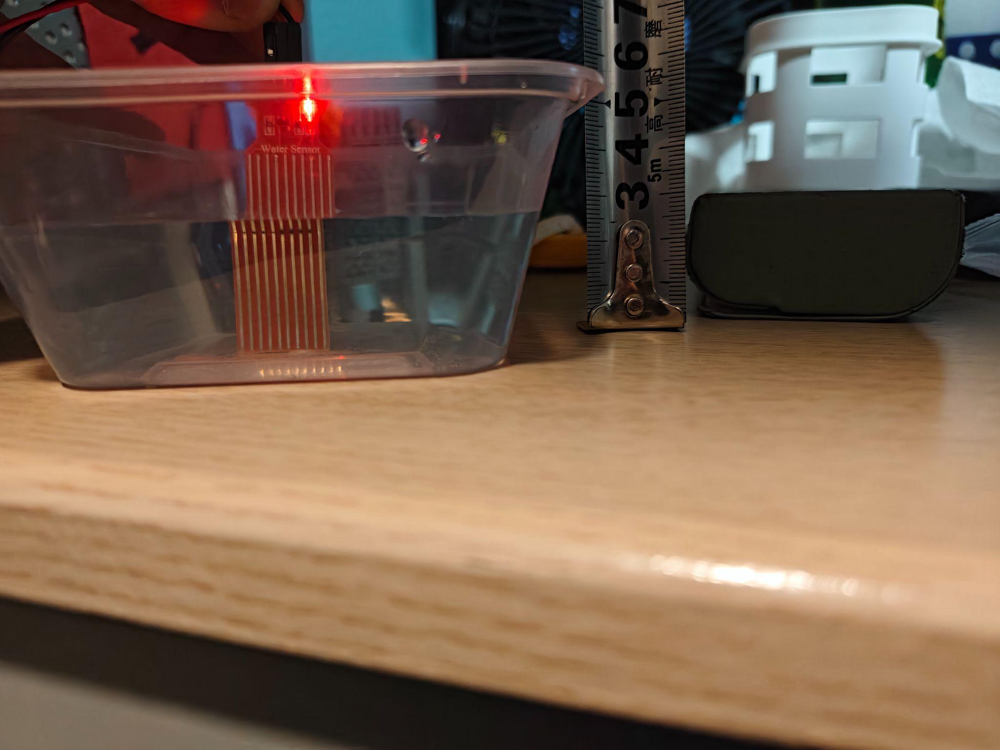

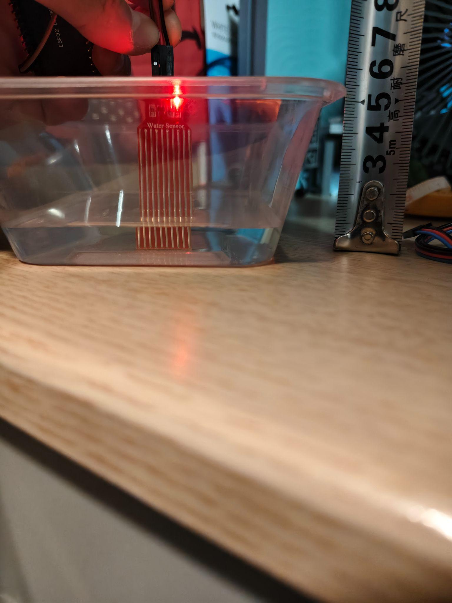

### 3.2 Observed response

| Condition | Initial response | Later response |
|---|---|---|
| 10 mm immersion | Started near 1450 ADC; peaked near 1616 after about 8.5 s | Gradually decreased to approximately 1350 by the end of 60 s |
| 30 mm immersion | Started near 1615 ADC and rose towards 1800 | Became much more stable after roughly 10 s, although some slow variation remained |

**10 mm evidence:**

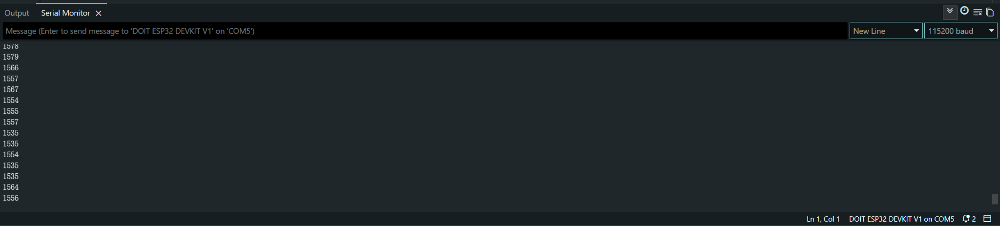

**30 mm evidence:**

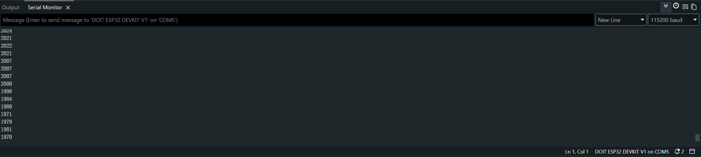

### 3.3 Analysis and limitations

The sensor output did not appear to depend solely on instantaneous water depth. Possible influences included:

- The length of exposed conductive tracks covered by water.
- A changing water film on the sensor surface.
- Minor changes in position or angle.
- The behaviour of the powered exposed resistive electrodes.

This experiment did **not** identify which mechanism was responsible. I therefore did not use these preliminary readings as final soil-calibration thresholds.

### 3.4 Decision for the next test

**Measurement timing needed to be controlled.** Comparing a reading collected two seconds after immersion with one taken fifteen seconds after immersion would not be a fair comparison. In subsequent trials I controlled immersion depth, sensor orientation and the measurement period more consistently.

## 4. Repeatability test at 30 mm

### 4.1 Test method

I tested whether the resistive probe gave similar readings when the same condition was repeated. I immersed it to **30 mm** in the same container and repeated the procedure **five times**, attempting to keep the orientation and measurement period consistent.

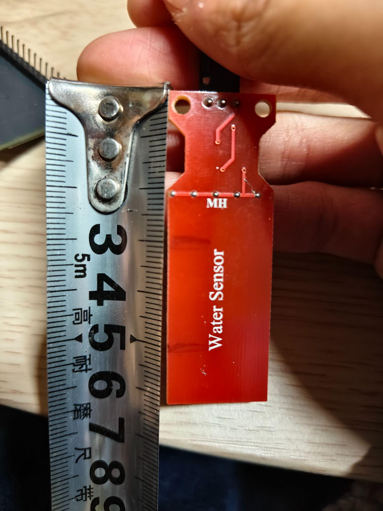

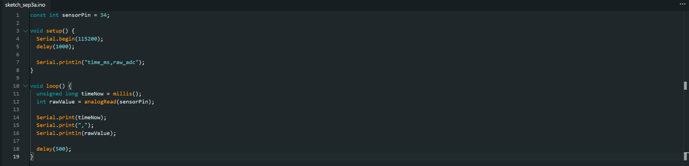

### 4.2 Results

| Trial | Mean ADC reading |
|---|---:|
| Trial 1 | 1871 |
| Trial 2 | 1915 |
| Trial 3 | 1905 |
| Trial 4 | 1919 |
| Trial 5 | 1886 |
| **Overall mean** | **1899** |

### 4.3 Analysis

The five trial means were closer to one another than some of the changes observed in the initial response-over-time tests. Within stable periods of individual trials, short-term variation was relatively small. This suggested that **random ADC noise was probably not the main cause** of the earlier, larger differences.

Changes to the physical sensing condition were likely more important, including:

- Insertion depth and orientation.
- Water wetting the probe's PCB surface.
- The precise position of the probe.
- The condition of exposed conductive tracks.

A limitation was that removing the probe could carry small amounts of water out of the container and slightly change the water level. The means did not consistently decline from one trial to the next, so this alone could not explain the observed variation.

### 4.4 Development decision

I initially expected software filtering to be the main reliability improvement. Repeatability testing changed that assessment: filtering might reduce small electronic fluctuations, but **repeatable physical placement and controlled testing were also essential**.

## 5. Ten-sample averaging / software filtering

### 5.1 Implementation and test

After the repeatability test, I modified the programme to compare a single raw ADC reading with the **average of ten ADC samples**, collected approximately **5 ms apart**.

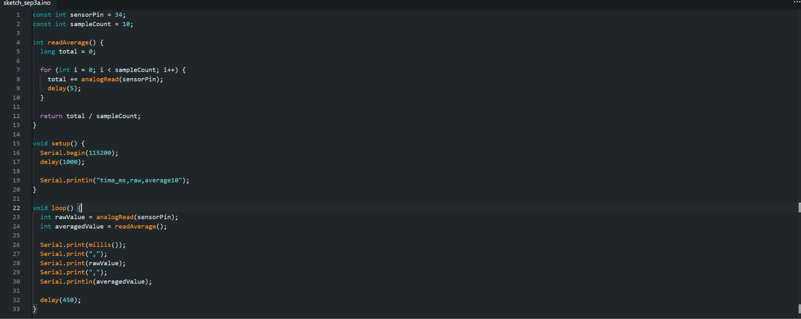

### 5.2 Results

The original Sprint 1 document reports these values from a stable section of the **third filtering test**:

| Measurement | Raw ADC | 10-sample average |
|---|---:|---:|
| Mean | 1820.8 | 1819.7 |
| Standard deviation | 4.74 | 3.64 |
| Range | 19 | 14 |

The standard deviation decreased by approximately **23%** and the range by approximately **26%**, while the mean remained nearly unchanged.

### 5.3 Interpretation

Averaging gave a measurable but modest reduction in short-term variability, rather than substantially shifting the underlying signal. Ten samples taken approximately 5 ms apart required about **50 ms** to gather. This delay was acceptable because soil moisture changes far more slowly.

**Decision:** I retained the 10-sample averaging method. It could smooth individual ADC fluctuations, but could not remove larger shifts caused by moving or reinserting the sensor. Physical placement and local calibration remained necessary.

## 6. Change to the capacitive soil-moisture sensor

### 6.1 Reason for the change

Once the ESP32 analogue-input and filtering methods were working, I replaced the preliminary resistive sensor with the **capacitive soil-moisture sensor** selected during the inquiry. This choice reduced reliance on exposed resistive electrodes and was better suited to sustained contact with damp soil.

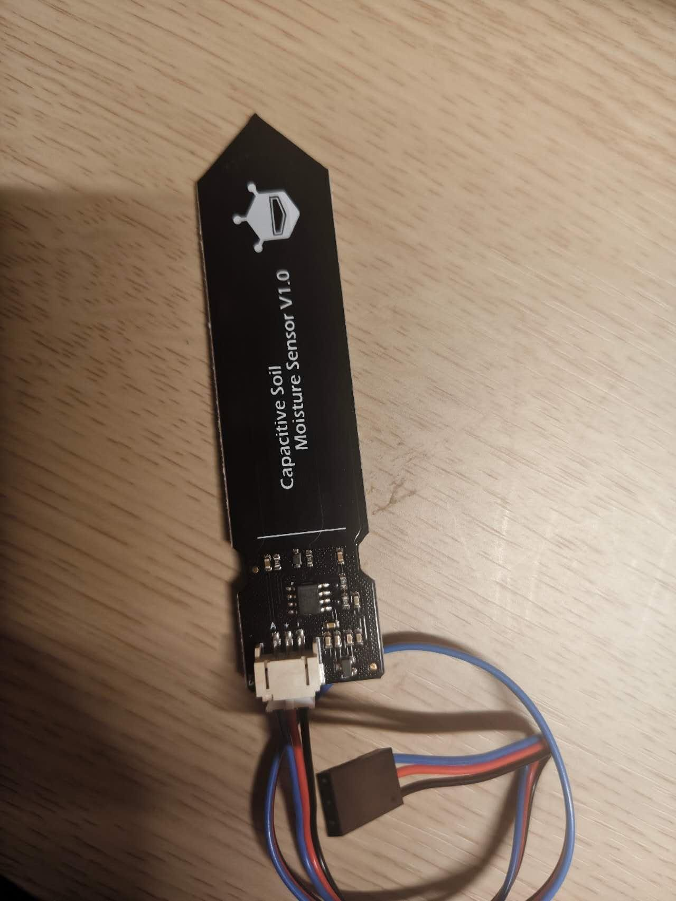

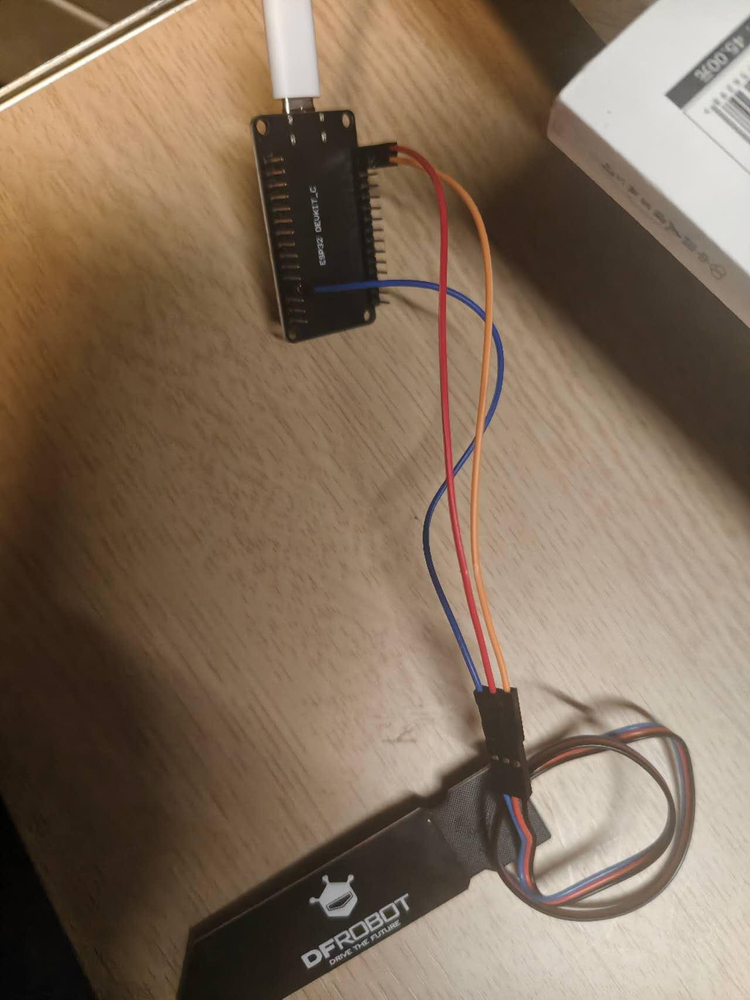

### 6.2 Initial air, dry-soil and wet-soil readings

| Test condition | Approximate filtered ADC reading |
|---|---:|
| Probe in air | 2947 |
| Probe inserted into relatively dry soil | 2562 |
| Soil after water was added | 1550–1560 |

### 6.3 Analysis

For this sensor, **higher ADC values represented drier conditions** and **lower ADC values represented wetter conditions** in these tests. The difference between relatively dry and wet soil was large enough to justify further calibration. The readings were not treated as universal moisture percentages; they were values for this particular probe and test arrangement.
