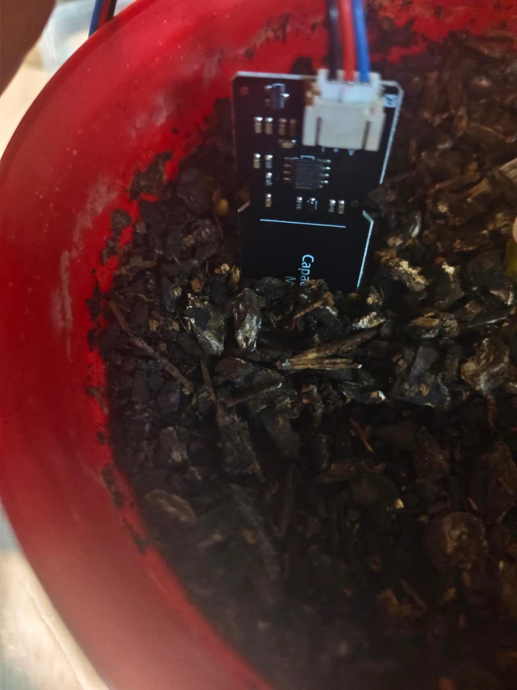
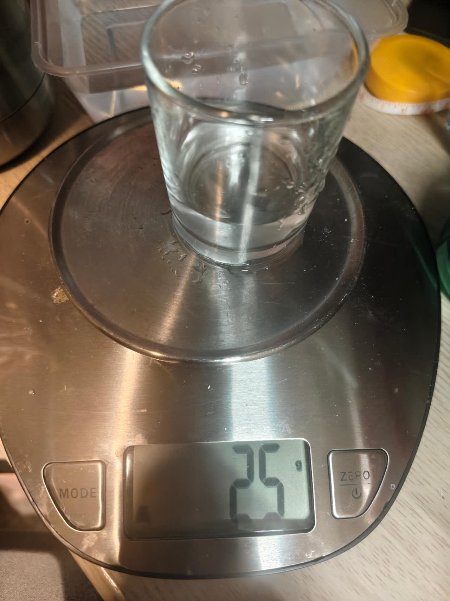
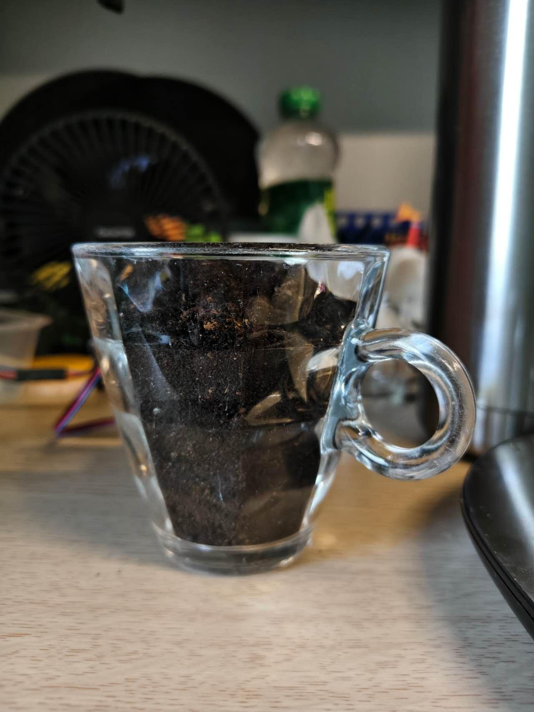
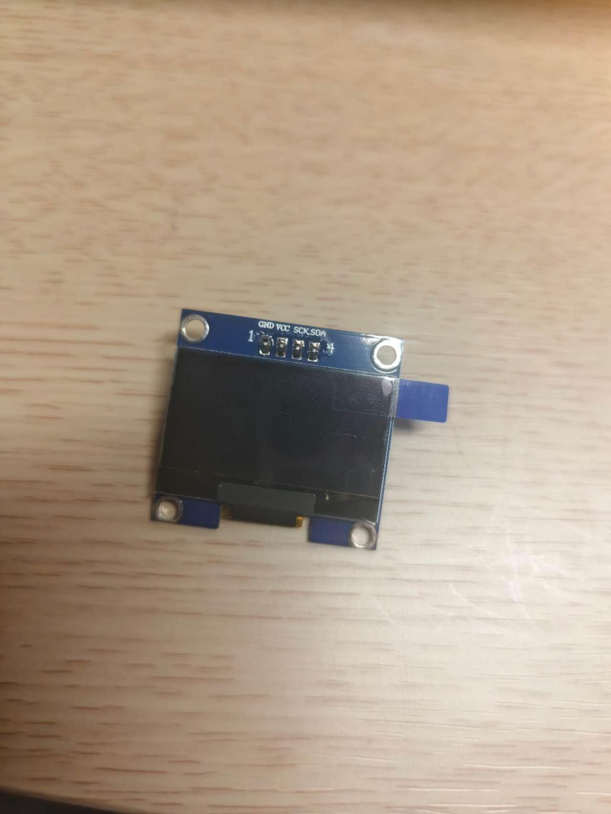
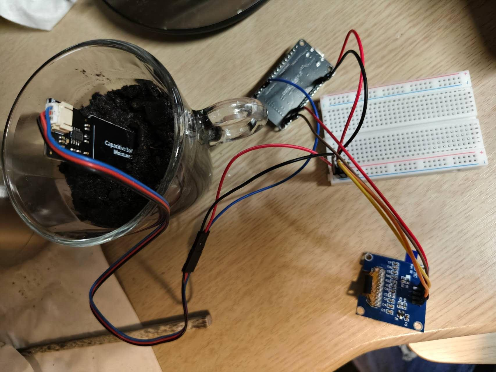
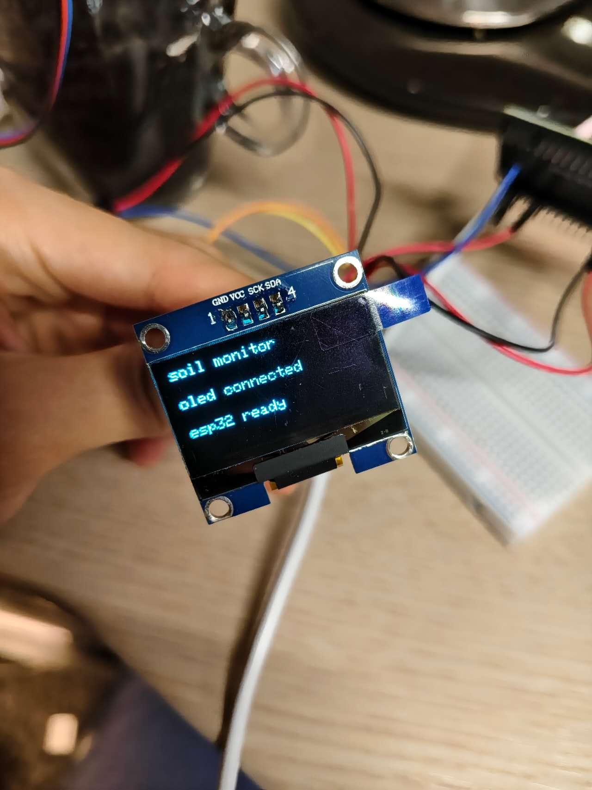
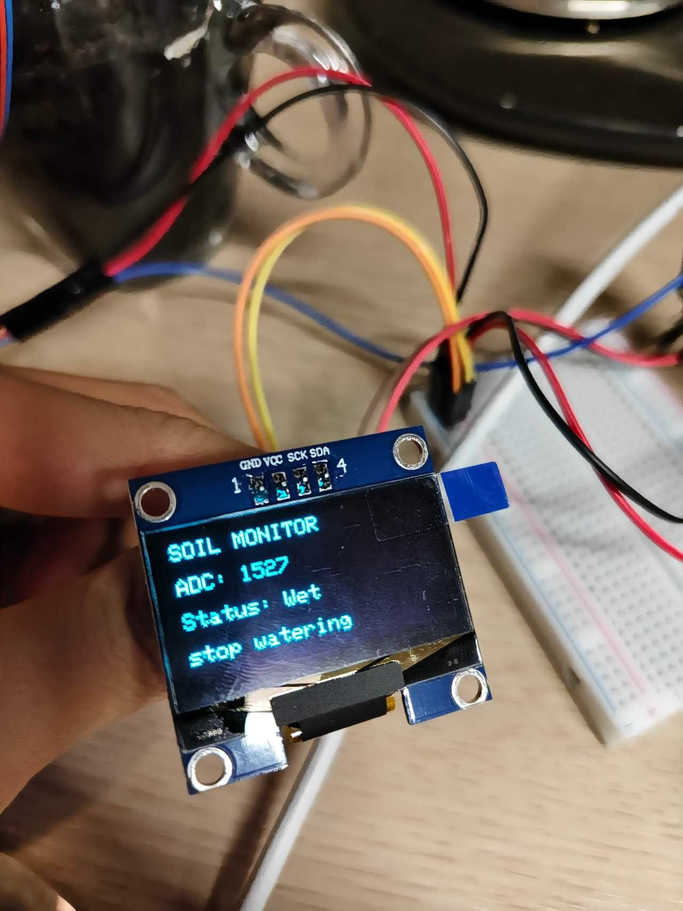
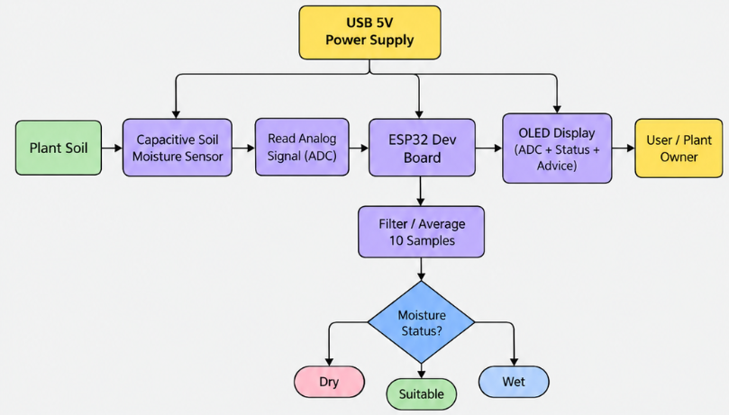

# Sprint 1 — MVP: Basic Framework and Functionality

**Project:** Smart soil monitoring and watering-support system  
**Controller:** ESP32  
**Sprint focus:** Analogue sensor acquisition, stability testing, local soil calibration, watering-status classification and a local OLED output.

This document records the development, tests, analysis, decisions and evidence for Sprint 1. The system is designed to help non-expert home and school gardeners interpret soil moisture readings as practical watering guidance, without treating a raw analogue value as a direct soil-moisture percentage.

---
## 1. Sprint 1 objectives and plan

The first priority of this sprint was to establish a reliable **sensing and processing framework** before introducing more complex features. I planned to:

1. Confirm that the ESP32 could receive a signal from an analogue sensor.
2. Investigate how the raw ADC output responded to changing physical conditions.
3. Test stability, response over time and repeatability.
4. Trial software filtering to reduce short-term variation.
5. Replace the preliminary resistive sensor with a capacitive soil-moisture sensor.
6. Calibrate soil conditions locally before setting Dry, Suitable and Wet categories.
7. Add a basic local output once the sensing and classification were working.

### Initial sensing approach

The resistive water sensor already available to me was suitable for **preliminary analogue-input experiments**, but not my intended final soil probe. My inquiry found that exposed resistive electrodes could corrode or drift in damp conditions. A capacitive sensor was considered more appropriate for extended contact with soil and was therefore selected for the later prototype.

### Scope decision

The MVP would prioritise trustworthy soil-moisture measurement and a simple recommendation over a wireless dashboard or fully automatic irrigation. A local display would allow users to check the soil condition without a computer, once basic sensing had been verified.

## 2. Preliminary resistive sensor and ESP32 ADC acquisition

### 2.1 Circuit and purpose

Before the capacitive probe was available, I connected a resistive water sensor to the ESP32 to test analogue acquisition:

| Connection | Configuration |
|---|---|
| Sensor supply | ESP32 3.3 V |
| Sensor ground | Common GND |
| Analogue signal | ESP32 GPIO34 (ADC1-capable input) |

I used **GPIO34** because the sensor output was an analogue signal and only needed to be read by the ESP32; the ESP32's ADC converts the voltage to a number for processing.

### 2.2 Hypothesis and results

I expected a low reading with dry exposed sensor tracks, and a higher ADC reading when those tracks contacted water.

| Test condition | Observed raw ADC |
|---|---:|
| Completely dry | 0 |
| Tracks in water, across later tests | Approximately 1500–2000 (varied with the physical test condition) |

### 2.3 Interpretation

This established that the **ESP32 could acquire an analogue sensor signal**. The ADC number was not, however, a calibrated soil-moisture percentage. Local calibration and attention to the sensing conditions would still be needed before that value could support watering decisions.

## 3. Response-over-time and immersion-depth tests

### 3.1 Reason for further testing

The preliminary sensor reading did not become stable immediately after immersion. Even when I tried to keep the physical condition unchanged, the displayed value could continue changing for several seconds. I therefore tested the reading over approximately **60 seconds** at two immersion depths: **10 mm** and **30 mm**.

### 3.2 Observed response

| Condition | Initial response | Later response |
|---|---|---|
| 10 mm immersion | Started near 1450 ADC; peaked near 1616 after about 8.5 s | Gradually decreased to approximately 1350 by the end of 60 s |
| 30 mm immersion | Started near 1615 ADC and rose towards 1800 | Became much more stable after roughly 10 s, although some slow variation remained |

**10 mm evidence:**

**30 mm evidence:**

### 3.3 Analysis and limitations

The sensor output did not appear to depend solely on instantaneous water depth. Possible influences included:

- The length of exposed conductive tracks covered by water.
- A changing water film on the sensor surface.
- Minor changes in position or angle.
- The behaviour of the powered exposed resistive electrodes.

This experiment did **not** identify which mechanism was responsible. I therefore did not use these preliminary readings as final soil-calibration thresholds.

### 3.4 Decision for the next test

**Measurement timing needed to be controlled.** Comparing a reading collected two seconds after immersion with one taken fifteen seconds after immersion would not be a fair comparison. In subsequent trials I controlled immersion depth, sensor orientation and the measurement period more consistently.

## 4. Repeatability test at 30 mm

### 4.1 Test method

I tested whether the resistive probe gave similar readings when the same condition was repeated. I immersed it to **30 mm** in the same container and repeated the procedure **five times**, attempting to keep the orientation and measurement period consistent.

### 4.2 Results

| Trial | Mean ADC reading |
|---|---:|
| Trial 1 | 1871 |
| Trial 2 | 1915 |
| Trial 3 | 1905 |
| Trial 4 | 1919 |
| Trial 5 | 1886 |
| **Overall mean** | **1899** |

### 4.3 Analysis

The five trial means were closer to one another than some of the changes observed in the initial response-over-time tests. Within stable periods of individual trials, short-term variation was relatively small. This suggested that **random ADC noise was probably not the main cause** of the earlier, larger differences.

Changes to the physical sensing condition were likely more important, including:

- Insertion depth and orientation.
- Water wetting the probe's PCB surface.
- The precise position of the probe.
- The condition of exposed conductive tracks.

A limitation was that removing the probe could carry small amounts of water out of the container and slightly change the water level. The means did not consistently decline from one trial to the next, so this alone could not explain the observed variation.

### 4.4 Development decision

I initially expected software filtering to be the main reliability improvement. Repeatability testing changed that assessment: filtering might reduce small electronic fluctuations, but **repeatable physical placement and controlled testing were also essential**.

## 5. Ten-sample averaging / software filtering

### 5.1 Implementation and test

After the repeatability test, I modified the programme to compare a single raw ADC reading with the **average of ten ADC samples**, collected approximately **5 ms apart**.

### 5.2 Results

The original Sprint 1 document reports these values from a stable section of the **third filtering test**:

| Measurement | Raw ADC | 10-sample average |
|---|---:|---:|
| Mean | 1820.8 | 1819.7 |
| Standard deviation | 4.74 | 3.64 |
| Range | 19 | 14 |

The standard deviation decreased by approximately **23%** and the range by approximately **26%**, while the mean remained nearly unchanged.

### 5.3 Interpretation

Averaging gave a measurable but modest reduction in short-term variability, rather than substantially shifting the underlying signal. Ten samples taken approximately 5 ms apart required about **50 ms** to gather. This delay was acceptable because soil moisture changes far more slowly.

**Decision:** I retained the 10-sample averaging method. It could smooth individual ADC fluctuations, but could not remove larger shifts caused by moving or reinserting the sensor. Physical placement and local calibration remained necessary.

## 6. Change to the capacitive soil-moisture sensor

### 6.1 Reason for the change

Once the ESP32 analogue-input and filtering methods were working, I replaced the preliminary resistive sensor with the **capacitive soil-moisture sensor** selected during the inquiry. This choice reduced reliance on exposed resistive electrodes and was better suited to sustained contact with damp soil.

### 6.2 Initial air, dry-soil and wet-soil readings

| Test condition | Approximate filtered ADC reading |
|---|---:|
| Probe in air | 2947 |
| Probe inserted into relatively dry soil | 2562 |
| Soil after water was added | 1550–1560 |

### 6.3 Analysis

For this sensor, **higher ADC values represented drier conditions** and **lower ADC values represented wetter conditions** in these tests. The difference between relatively dry and wet soil was large enough to justify further calibration. The readings were not treated as universal moisture percentages; they were values for this particular probe and test arrangement.

## 7. Local calibration in the intended soil

### 7.1 Method

Because my inquiry found that soil type and installation conditions can affect sensor results, I carried out a local calibration rather than copying thresholds from another source.

I used approximately **100 g of soil** in a small container and progressively added measured quantities of water. From the 10 mL test onward I tried to leave the sensor in the same position, so a change in insertion depth would not be confused with a change in moisture. I also recorded values over time instead of relying on the first reading immediately after watering. The **0-water condition** represented the soil before any water was added.

### 7.2 Recorded calibration data

| Added water (g in the original table) | Filtered mean ADC | Observation |
|---|---:|---|
| 0 | 2736 | Dry, loose soil |
| 10 | 2663 | Slightly damp |
| 15 | 2428 | Not recorded |
| 20 | 2065 | Not recorded |
| 25 | 1907 | Moist; no standing water |
| 30 | 1820 | Not recorded |
| 45 | 1830 | Very wet |
| 60 | 1519 | Dark soil; some surface water |

> **Original-document unit note:** the data table labels the added water in **g**, whereas the accompanying paragraphs sometimes describe additions in **mL**. Both usages appear in the source document; this transcription preserves the table's unit rather than silently reconciling them.

### 7.3 Analysis

In general, the ADC value **decreased as water was added**, supporting the direction found in the initial capacitive-probe test. The response was **not perfectly linear**: the reading at 30 (about 1820) was slightly lower than the later 45 reading (about 1830), despite the larger quantity of added water. The values also continued changing as moisture spread through the soil.

Consequently, waiting time, moisture distribution and sensor position needed to be considered when interpreting readings. These experimental values provided locally observed reference points; they did not establish a universal calibration for all soils or plants.

## 8. Dry / Suitable / Wet classification and threshold tests

### 8.1 Choosing reference conditions

I selected three reference observations from the soil calibration:

| Reference condition | Filtered ADC | Physical observation |
|---|---:|---|
| Dry | 2736 | Soil dry before watering |
| Suitable | 1907 | Moist soil without standing water at the 25-water point |
| Wet | 1519 | Darker soil with some surface water at the 60-water point |

I used the midpoints between the reference readings as **initial boundaries** for three states, rather than treating the ADC number itself as a meaningful percentage.

### 8.2 Classification table

| Filtered ADC value | Moisture status | User-facing advice |
|---|---|---|
| **2322 and above** | **DRY** | Water soon |
| **1714–2321** | **SUITABLE** | No watering needed |
| **1713 and below** | **WET** | Do not water |

This converts the filtered sensor input into a direct recommendation that a beginner gardener can interpret.

### 8.3 Boundary testing

I tested inputs immediately on either side of both thresholds:

| Test ADC | Expected / observed classification |
|---|---|
| 2322 | DRY |
| 2321 | SUITABLE |
| 1714 | SUITABLE |
| 1713 | WET |

The programme returned the intended state at each of these exact boundary values, confirming that the conditional comparisons worked for the initial thresholds.

### 8.4 Hysteresis refinement

I then introduced **hysteresis**: instead of switching state whenever a reading crossed a single numerical boundary, the value had to move further into the next band before the status changed. I used this approach around both the Dry/Suitable and Suitable/Wet transitions.

The source document reports that the display stayed more stable near thresholds while still responding to meaningful moisture changes. **The exact numeric hysteresis margins were not specified in the source**, so they are not invented here.

**Decision:** Keep ten-sample filtering, calibrated status bands and hysteresis together. They address different problems: small sampling noise, local moisture interpretation and rapid switching at category boundaries.

## 9. Integrating the SH1106 OLED local display

### 9.1 Display choice and tests

Once moisture measurement and classification worked, I added a **1.3-inch, 128 × 64 SH1106 OLED**. The purpose was to show actionable soil information without requiring a computer or knowledge of ADC values.

I first used an **I²C scanner** to verify that the ESP32 could detect the display. I then tested simple text output before presenting moisture-status information.

The final Sprint 1 interface presented the **soil state and watering recommendation as the main information**, with a smaller raw/filtered value retained for transparency and troubleshooting.

### 9.2 Integrated subsystems

| Subsystem | Function |
|---|---|
| Capacitive sensing | Changes in the dielectric environment around the probe produce an analogue output; the sensor does not return a direct moisture percentage |
| Analogue acquisition | GPIO34 / ADC1 on the ESP32 converts the analogue voltage into an ADC number |
| Filtering | Ten samples, gathered about 5 ms apart, are averaged to reduce short-term variation |
| Processing | Locally calibrated bands and hysteresis convert the averaged value into a stable soil state |
| Output | The SH1106 OLED shows the moisture state and watering recommendation |
| Debugging | Serial output remains available to view raw and filtered values during development |

### 9.3 Signal and data flow

**Soil → capacitive probe (analogue voltage) → ESP32 GPIO34 ADC → 10-sample average → calibrated classification with hysteresis → OLED message.**

The OLED uses **I²C**, with **GPIO21 as SDA** and **GPIO22 as SCL**. The ESP32 controls the bus and sends display data; the two signal lines reduce the number of GPIO connections compared with a parallel display interface.

### 9.4 Operational sequence

1. Power is supplied and the ESP32 starts.
2. Serial communication is initialised.
3. The OLED / I²C link is initialised.
4. The ESP32 collects ten moisture-sensor ADC samples.
5. The samples are averaged.
6. The filtered result is classified using local thresholds and hysteresis.
7. The OLED displays the current condition and watering guidance.
8. After a short wait, the cycle repeats.

### 9.5 Communication interfaces

**Analogue ADC:** The capacitive sensor sends a varying voltage to the ESP32; there is no digital packet or bus protocol between this sensor and the ADC input.

**I²C:** The OLED uses SDA to carry data and SCL as the clock signal. This is suitable for a small display and leaves the possibility of adding other devices to the I²C bus later, subject to compatible addresses and wiring.

## 10. Client / stakeholder / expert feedback

The original Sprint 1 report states that I showed the OLED prototype to **five potential users** and asked them to interpret its statuses without extra explanation. Most found the large status text easier to understand than a raw ADC number.

- **Two users** liked having a numerical reading available for transparency, but did not want it to dominate the main display.
- **One user** suggested replacing **“OK”** with **“SUITABLE”**, because “OK” might wrongly imply that the *whole plant* was healthy, rather than describing soil moisture alone.
- I accepted that suggestion and changed the advice to **“SUITABLE — No watering needed”** to make the scope of the statement clearer.

The source identifies two household stakeholders, one school gardener and one industry expert among these respondents, but does not clearly specify the fifth respondent's role. No extra participant details are added here.

### Impact of feedback

The decision supported the main design objective: communicate **actionable watering guidance** while avoiding overclaiming what a moisture probe measures. Numerical ADC information could remain in a secondary position for checking and calibration.

## 11. Sprint 1 outcome and next steps

### Achieved in this sprint

By the end of the documented Sprint 1 sequence, the prototype had:

- Established ESP32 analogue sensing using GPIO34.
- Compared immersion response and repeatability in a preliminary resistive probe.
- Measured a modest improvement from ten-sample averaging.
- Migrated to capacitive soil sensing.
- Collected local soil calibration observations.
- Produced Dry, Suitable and Wet decisions, including boundary checks and hysteresis.
- Displayed the soil condition and advice locally using the SH1106 OLED.
- Refined a status label based on user feedback.

### Planned for Sprint 2 — not claimed as completed in Sprint 1

The next stage would focus on **permanent/perfboard wiring**, stronger connectors, cable strain relief, moisture protection and an enclosure. The plan also included integrating a **DS18B20 temperature sensor**, then deciding whether temperature should influence advice or simply appear as extra information.

Wireless logging and a dashboard remained **optional later extensions**. The inquiry identified additional Wi-Fi, privacy, data-storage and debugging complexity, so these would only be considered after the local prototype was reliable.

---

*Evidence note: descriptions, measurements, pictures and reported stakeholder feedback are taken from the Sprint 1 portion of the provided assessment document. Screenshot images are preserved rather than converted into guessed source code. Specific elapsed dates for the individual experiments were not given in that document.*
